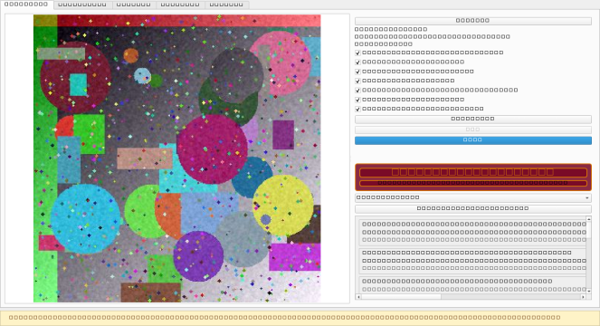
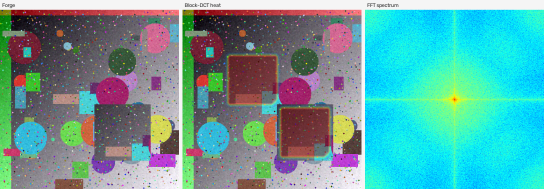
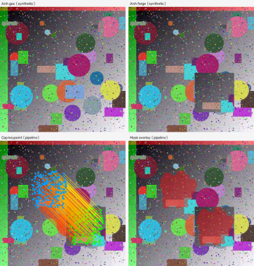

# Báo cáo đồ án — ImageGuard Forensics (bản nháp chương 1–7)

> **Trạng thái:** nháp cho sinh viên chỉnh sửa. Ranh giới khoa học: *dấu hiệu nghi vấn*
> / *suspicious indication* — không khẳng định ảnh giả hay xác thực nguyên bản.

Khung đầy đủ: [`capstone-skeleton.md`](capstone-skeleton.md).

[SINH VIÊN BỔ SUNG: trang bìa — họ tên, MSSV, lớp, giảng viên hướng dẫn, ngày nộp.]

---

## Chương 1 — Đặt vấn đề và phạm vi

### 1.1 Bối cảnh

Ảnh số dễ bị chỉnh sửa cục bộ (copy-move: sao một vùng và dán vào chỗ khác trong
cùng khung hình). Trong môn xử lý ảnh và bài toán điều tra ngoại đời, người dùng
cần công cụ **offline**, có mask/heatmap giải thích, nhưng không được đánh đổi
độ tin cậy khoa học để lấy “kết luận dứt khoát”.

[SINH VIÊN BỔ SUNG: ví dụ tình huống cụ thể tại lớp hoặc use-case cá nhân,
không dùng ảnh nhạy cảm.]

### 1.2 Phát biểu vấn đề

Cho ảnh tĩnh đầu vào (định dạng được `safe_open` chấp nhận), hệ thống cần:

- chạy một hoặc nhiều phương pháp forensics (keypoint, block DCT, và các cue
  bổ trợ);
- hợp nhất thành **verdict năm trạng thái** và báo cáo có `score_definition`;
- lưu lịch sử, xuất Markdown, hỗ trợ đọc overlay trên GUI.

Đầu ra là **chỉ dẫn kỹ thuật** (báo cáo, mask, metadata phương pháp), không phải
phán quyết pháp y.

### 1.3 Câu hỏi nghiên cứu

1. Keypoint (SIFT/ORB) và block DCT cho **recall ảnh mức**, **FPR**, và tỷ lệ
   **INCONCLUSIVE** thế nào trên các tập benchmark có oracle mask rõ ràng
   (synthforge, CoMoFoD dev, cohort CASIA đã sàng lọc)?
2. Fusion verdict và giao diện có giúp người dùng **đọc dấu hiệu** mà không
   hiểu nhầm là “ảnh giả” không? (Fusion app: **chưa đánh giá** trong sự kiện
   formal hai-method — xem [`README.md`](../../README.md).)
3. Pipeline có **tái lập** được không (seed, hash cấu hình, artifact eval)?

### 1.4 Đóng góp (map mã nguồn)

| Đóng góp | Vị trí mã |
| --- | --- |
| Pipeline đa-method + fusion | `src/imageguard/forensics/fusion.py` (mô tả, không chỉnh trong scope báo cáo) |
| Eval có seed | `src/imageguard/evaluation/synthforge.py`, `runner.py` |
| Desktop + export Markdown | `src/imageguard/services/report_service.py`, `src/imageguard/ui/screens/analyze.py` |

### 1.5 Đạo đức, phạm vi và giới hạn tuyên bố

- **Phạm vi sản phẩm:** ảnh tĩnh; không camera stream; không khẳng định nguồn
  gốc pháp lý.
- **Wording:** `SUSPICIOUS` = dấu hiệu nghi vấn; `NO_INDICATION` ≠ chứng minh
  authentic; `INCONCLUSIVE` = không đủ bằng chứng — báo riêng, không gộp vào
  “đúng/sai” đơn giản ([`docs/evaluation-methodology.md`](../evaluation-methodology.md)).
- **Dataset ngoài:** CoMoFoD tải tay, không redistribute; CASIA chỉ mô tả
  cohort **103+103 cặp** đã sàng lọc nội bộ với **oracle mask tác giả** — không
  coi là ảnh camera tùy ý ([`docs/dataset-strategy.md`](../dataset-strategy.md),
  [`README.md`](../../README.md)).
- **Ứng dụng học thuật:** kết quả không thay thế kiểm chứng độc lập; tab Enhance
  / NAFNet chỉ xem, không đưa vào verdict phân tích.

**Nguồn:** [`docs/report/capstone-skeleton.md`](capstone-skeleton.md) (mục giới thiệu,
đạo đức); [`README.md`](../../README.md); [`docs/limitations.md`](../limitations.md).

---

## Chương 2 — Cơ sở lý thuyết

### 2.1 Copy-move và khảo sát phương pháp cổ điển

Copy-move tạo hai vùng **cùng nội dung pixel/texture** trong một ảnh. Hai hướng
chính trong đồ án:

- **Keypoint (sparse):** SIFT/ORB, bất biến scale/rotation cục bộ; nhạy JPEG/nhiễu
  và vùng phẳng.
- **Block DCT (dense):** khớp block đã DCT + lượng tử hóa; mạnh trên translate
  texture đều, yếu khi rotate/scale.

Christlein et al. (2012) tóm tắt trade-off benchmark — đọc kèm [`docs/reading-list.md`](../reading-list.md) mục 2.

### 2.2 Block matching và DCT (Fridrich et al.)

Ảnh xám chia block chồng lấn; mỗi block → DCT-II, lượng tử, vector hệ số zigzag.
Block giống nhau → vector gần nhau; **sắp xếp từ điển** giảm độ phức tạp so với
so khớp bậc hai. Cặp block hợp lệ gom theo **bỏ phiếu vector dịch (shift voting)**.
Vùng phẳng lọc bằng ngưỡng độ lệch chuẩn block để giảm false match.

Chi tiết triển khai: [`docs/algorithms/03-block.md`](../algorithms/03-block.md).

**Tài liệu:** Fridrich, Soukal, Lukáš (2003) — [`docs/reading-list.md`](../reading-list.md) #1.

### 2.3 Keypoint: SIFT/ORB, Lowe ratio, RANSAC

**SIFT (Lowe 2004):** scale-space, DoG keypoints, descriptor 128 chiều. **Self-match**
k-NN (k=3), bỏ cặp cùng điểm; **Lowe ratio test** `‖d₁‖/‖d₂‖ < ρ` (ρ cấu hình
trong `thresholds.yaml`) để loại texture lặp ngẫu nhiên.

**Hình học:** `findHomography` / affine với **RANSAC** — mô hình affine 2×3,
inlier theo ngưỡng pixel; thêm **displacement clustering** cho nhiều vùng translate.

Chi tiết: [`docs/algorithms/02-keypoint.md`](../algorithms/02-keypoint.md).

**Tài liệu:** Lowe (2004) #3; OpenCV RANSAC — reading-list #9.

### 2.4 ELA (Error Level Analysis)

`ELA(x,y) = |I(x,y) − R_q(I)(x,y)|` với `R_q` là JPEG re-encode ở chất lượng q.
Vùng có lịch sử nén khác → mức lỗi khác. ELA chỉ mang tính **khám phá**: re-save
xoá vệt; texture tự nhiên cũng gây false cue — trong app **không** đủ để một
mình ra `SUSPICIOUS` ([`docs/algorithms.md`](../algorithms.md)).

**Tài liệu:** Krawetz (2007) #4.

### 2.5 Noise residual và MAD

Residual `r = I − median_k(I)` giữ thành phần cao tần. Ước lượng σ theo block
bằng **MAD**: `σ̂ = 1.4826·median|r|`. Vùng lệch so với median±m·MAD toàn ảnh
→ bản đồ outlier. Denoise/sharpen hợp pháp có thể mô phỏng dấu hiệu tương tự; cue
noise tối đa **INCONCLUSIVE**.

**Tài liệu:** Lukáš, Fridrich, Goljan (2006) #6 (PRNU đầy đủ là hướng mở rộng).

### 2.6 Phân tích tần số (frequency)

FFT2 biên độ (log) phát hiện lưới JPEG 8×8, peak định kỳ khi resampling; clone
đôi khi đổi phổ cục bộ. Metric blockiness so sánh gradient biên block với nội
block. Chỉ cue khám phá — không verdict độc lập ([`docs/algorithms.md`](../algorithms.md)).

**Hình minh họa:** phổ và block-DCT synthetic — xem Hình 2.

### 2.7 So sánh ngắn với học sâu end-to-end

Đồ án chọn pipeline cổ điển có giải thích (mask, evidence JSON) thay vì mạng
ảnh-vào-nhãn-ra — phù hợp phạm vi môn và yêu cầu audit ngưỡng. Hướng ML chỉ
design: [`docs/ml-extension.md`](../ml-extension.md).

**Nguồn:** [`docs/algorithms.md`](../algorithms.md);
[`docs/algorithms/02-keypoint.md`](../algorithms/02-keypoint.md);
[`docs/algorithms/03-block.md`](../algorithms/03-block.md);
[`docs/reading-list.md`](../reading-list.md).

---

## Chương 3 — Thiết kế hệ thống

### 3.1 Kiến trúc phân lớp

```
UI (PySide6) → Services → Forensics engine (Qt-free) → Core I/O
     ↓              ↓              ↓
 Persistence (SQLite + artifacts) ; Evaluation / Ingest / Enhancement (song song)
```

- **Engine Qt-free:** `forensics/`, `core/`, `evaluation/` test headless bằng pytest.
- **UI thread:** không chạy OpenCV; worker qua `QThreadPool` (max 1 thread).
- **Ngưỡng tập trung:** `configs/thresholds.yaml` (không chỉnh trong scope báo cáo).

Sơ đồ đầy đủ: [`docs/architecture.md`](../architecture.md) (ASCII layer diagram).

**Hình 1** — Giao diện tab Phân tích (ảnh synthetic, không dữ liệu nhạy cảm):



**Hình 2** — Cue block-DCT và phổ tần số trên ảnh synthetic:



**Hình 3** — Ví dụ localization keypoint trên forge synthetic:



Các tab Enhance, History, Settings, Stats: `figures/gui_tab_*.png` — metadata
trong [`figures.md`](figures.md).

[SINH VIÊN BỔ SUNG: sơ đồ layer H1 và luồng sequence H2 nếu giảng viên yêu cầu
— hiện chưa có file vector trong repo; vẽ theo `architecture.md`.]

### 3.2 Luồng dữ liệu một lần phân tích

```
file → safe_open → ImageDocument → preprocess/theo method
  → method.analyze() → AlgorithmResult[]
  → fusion.adjudicate() → ForensicReport
  → artifacts/{id}/ + SQLite (relative paths)
```

Ingest folder gọi cùng `AnalysisService` headless, ghi custody — không đổi pipeline
verdict ([`docs/architecture.md`](../architecture.md)).

### 3.3 Dịch vụ (services)

| Service | Vai trò |
| --- | --- |
| `AnalysisService` | orchestrate methods + fusion + persist |
| `HistoryService` | truy vấn analyses, reopen |
| `ReportService` | xuất Markdown từ `ForensicReport` |
| `EvaluationService` | CLI eval synth / CoMoFoD |

Giao diện: [`docs/service-interface.md`](../service-interface.md).

### 3.4 Lưu trữ

SQLite `data/imageguard.db` (gitignored): `image_assets`, `analyses`,
`method_results`, `artifacts`, `experiments`. File mask/heat/report JSON trong
`data/artifacts/<analysis_id>/`. Chỉ **đường dẫn tương đối** — không lưu absolute
path ([`docs/database.md`](../database.md)).

### 3.5 Giao diện người dùng

Năm tab: Analyze | Enhance | History | Stats | Settings; câu lưu ý nằm trong báo cáo (không có thanh riêng);
wording “dấu hiệu” trong `src/imageguard/ui/strings.py`
([`docs/ui-design.md`](../ui-design.md)).

Quyết định kỹ thuật GUI (tóm tắt):

| Quyết định | Lựa chọn | Lý do |
| --- | --- | --- |
| Threading | `QThreadPool` max 1 | Giới hạn RAM |
| Qt bridge | `.copy()` mọi `QImage` | Tránh dangling pointer |
| Aux methods | Chỉ tăng INCONCLUSIVE | Tránh overclaim |

### 3.6 Bảo mật và lỗi

`safe_open`: magic byte, giới hạn kích thước/decode; không thực thi payload ảnh
([`docs/security-error-handling.md`](../security-error-handling.md)).

**Nguồn:** [`docs/architecture.md`](../architecture.md); [`docs/database.md`](../database.md);
[`docs/ui-design.md`](../ui-design.md); [`docs/report/figures.md`](figures.md).

---

## Chương 4 — Phương pháp thực nghiệm

### 4.1 Ranh giới đo lường

Metrics đo **dấu hiệu suspicious** và localization cue so với oracle — **không**
chứng minh authentic/giả cho ảnh bất kỳ. `INCONCLUSIVE` báo tách; ELA/noise/freq
không tạo `SUSPICIOUS` độc lập ([`docs/evaluation-methodology.md`](../evaluation-methodology.md)).

### 4.2 Bộ dữ liệu

| Dataset | Vai trò | Ghi chú |
| --- | --- | --- |
| **synthforge** | Dev/regression nội bộ | PCG64 seed, tiers easy/medium/hard; không benchmark công bố ([`docs/dataset-strategy.md`](../dataset-strategy.md)) |
| **CoMoFoD** | Diagnostic / dev ngoài | Tralic et al. ELMAR-2013; tải tay vào `data/comofod_base/`; verify mask trước eval ([`docs/dataset-strategy.md`](../dataset-strategy.md)) |
| **CASIA (cohort formal)** | Sự kiện locked | **103 cặp** ảnh đã sàng lọc: 103 chỉnh + 103 gốc; oracle mask tác giả; **không** coi là cohort ảnh chụp tùy ý ([`README.md`](../../README.md)) |

Split synth/CoMoFoD: theo `base_image_id` (`sha256 % 2`) — mọi biến thể cùng ảnh
gốc cùng phía dev hoặc test; **không hiệu chỉnh ngưỡng trên split test khóa**.

[SINH VIÊN BỔ SUNG: điền n và seed cụ thể của lần chạy synth/CoMoFoD sau khi mở
JSON eval — không chép nếu chưa verify file.]

### 4.3 Metric

**Ảnh mức:** precision, recall, F1, specificity; confusion với lớp dương =
`SUSPICIOUS`; đếm `INCONCLUSIVE` riêng.

**Pixel mức (R1–R5):**

- **R1:** chỉ chấm localization khi GT mask không rỗng.
- **R2:** mask dự đoán rỗng trên GT có vùng → recall/F1/IoU = 0, vẫn trong mẫu số.
- **R3:** mask không rỗng trên ảnh authentic → false cue (area ratio).
- **R4:** authentic sạch → điều khiển, loại khỏi aggregate pixel.
- **R5:** split thiếu lớp → metric phụ thuộc lớp = `N/A`.

Bổ sung ModelBench: **IoU**, **boundary-F1@8** trên ảnh chỉnh có GT
([`docs/evaluation-methodology.md`](../evaluation-methodology.md)).

### 4.4 Giao thức (leakage, manifest, locked event)

1. **Cô lập theo scene:** nhóm theo ID ảnh gốc / pixel gốc; không trộn biến thể
   cùng base giữa dev và test.
2. **Manifest đóng băng:** `scripts/evaluate_detector_quality.py freeze` — hash file,
   mask nhị phân; protocol v2 trong [`docs/evaluation-methodology.md`](../evaluation-methodology.md).
3. **Dev:** chẩn đoán và đề xuất candidate; **locked:** baseline/candidate với
   `--pair-contract`, seed cố định, role receipt; không chỉnh candidate sau khi
   xem output test.
4. **So sánh:** `compare` với tiêu chí **đăng ký trước** (hash criteria trong contract).

Lệnh eval thường: `python -m imageguard eval` — ghi experiment id, config hash,
git SHA ([`docs/user-guide.md`](../user-guide.md)).

### 4.5 Kết quả baseline formal (CASIA 103+103) — chỉ số đã công bố trong repo

Theo [`README.md`](../../README.md) và [`docs/limitations.md`](../limitations.md)
(từ một sự kiện đánh giá formal trên cohort đã nêu):

| Phương pháp | Trên ảnh chỉnh (n=103) | Trên ảnh gốc (n=103) |
| --- | --- | --- |
| Keypoint | 94 suspicious; 9 INCONCLUSIVE | 22 FP suspicious; 59 INCONCLUSIVE (trong nhóm nonsuspicious confusion) |
| Block | **37** suspicious; 2–3 INCONCLUSIVE | **0** FP suspicious |

- Keypoint edited recall ~**91,26%** trên cohort này; original FPR ~**21,36%** (22/103).
- Macro IoU mask (103 chỉnh): keypoint ~**0,461**; block ~**0,289**.
- **Fusion UI:** `NOT_EVALUATED` trong sự kiện hai-method trên.

[SINH VIÊN BỔ SUNG: trích lại từ JSON sự kiện đã lưu khi nộp bản chính thức —
README chỉ là tóm tắt định tính.]

### 4.6 Nghiên cứu candidate (block) — kết quả **FAIL**

Mục tiêu đã đăng ký (ví dụ trên cùng cohort formal): cải thiện **recall ảnh mức**
(block coi `SUSPICIOUS` trên ảnh chỉnh) ít nhất **+5** so với baseline, đồng thời
giữ FPR gốc trong ngưỡng đã duyệt.

| Vai trò | Số ảnh chỉnh được coi suspicious (trên 103) | Ghi chú |
| --- | --- | --- |
| Baseline (config khóa) | **37/103** | Khớp bảng formal trong [`README.md`](../../README.md) |
| Candidate | **38/103** | Cải thiện **+1**, không đạt ngưỡng **+5** |

**Kết luận sự kiện:** `compare` **rejected** — candidate **không được chấp nhận**;
ngưỡng production **không** đổi theo kết quả này.

[SINH VIÊN BỔ SUNG: dán `comparison.json` / receipt hash từ `evaluate_detector_quality.py compare`.]

**Nguồn:** [`docs/evaluation-methodology.md`](../evaluation-methodology.md);
[`scripts/evaluate_detector_quality.py`](../../scripts/evaluate_detector_quality.py);
[`README.md`](../../README.md); [`docs/dataset-strategy.md`](../dataset-strategy.md).

---

## Chương 5 — Kết quả thực nghiệm

### 5.1 Ba mức bằng chứng, không cộng gộp

Chương này giữ nguyên ba mức bằng chứng mà repo đã tách sẵn; số của mức này
**không** được dùng để bù cho mức kia.

| Mức | Dữ liệu | Được phép nói | Không được phép nói |
| --- | --- | --- | --- |
| **Formal (đã chấm điểm)** | Cohort CASIA đã sàng lọc: 103 cặp gốc/chỉnh, oracle mask tác giả | Đếm verdict và macro IoU của **từng detector đơn lẻ** trên cohort này | Độ chính xác trên ảnh camera tùy ý; FPR phổ quát |
| **Fusion offline (khám phá)** | Cùng 103 cặp; áp luật `fusion.combine` lên **hàng detector đã lưu** | Đếm verdict gộp trên đúng artifact đó | Held-out mới; chứng minh fusion “tốt hơn” ngoài cohort |
| **Exploratory (synth/modelforge)** | Ảnh sinh nội bộ, n rất nhỏ | Mô tả hành vi pipeline theo distortion | Ước lượng accuracy/FPR; so sánh với bảng formal |

**Nguồn:** [`README.md`](../../README.md) mục “Giới hạn đã đo (không overclaim)”;
[`docs/algorithms/comparison.md`](../algorithms/comparison.md) (tách mục 1 formal /
mục 2 exploratory); [`docs/fusion-offline-analysis.md`](../fusion-offline-analysis.md).

### 5.2 Sự kiện formal CASIA — detector đơn lẻ

**Bảng 5.1** — Đếm verdict và macro IoU trên cohort CASIA đã sàng lọc (103 cặp;
oracle mask tác giả, **không** phải ảnh chụp camera tùy ý).

| Phương pháp | Ảnh chỉnh (n=103): `SUSPICIOUS` | Ảnh chỉnh: `INCONCLUSIVE` | Ảnh gốc (n=103): `SUSPICIOUS` | Ảnh gốc: `INCONCLUSIVE` | Macro IoU mask (103 ảnh chỉnh) |
| --- | ---: | ---: | ---: | ---: | ---: |
| Keypoint (SIFT) | **94** (9 FN) | **9** | **22** (false cue) | **59** | **~0,461** |
| Block (DCT, baseline `.01`) | **37** (66 không suspicious) | **3** | **0** | **0** | **~0,289** |

Đọc bảng:

- Keypoint: 94 + 9 = 103 ảnh chỉnh. Chín ảnh còn lại đều `INCONCLUSIVE`, nên theo
  cách đếm của repo chúng cũng là FN ([`README.md`](../../README.md)).
- Block: 37 `SUSPICIOUS` + 3 `INCONCLUSIVE` + 63 `NO_INDICATION` = 103 ảnh chỉnh;
  con số “66 không suspicious” là 3 + 63
  ([`docs/algorithms/comparison.md`](../algorithms/comparison.md)).
- Cột ảnh gốc của block **0/103** chỉ đúng trên mẫu này —
  [`README.md`](../../README.md) và [`docs/limitations.md`](../limitations.md)
  nhấn mạnh **không** suy ra FPR = 0 cho mọi nguồn ảnh.
- Keypoint edited recall ~**91,26%**; original FPR ~**21,36%** (22/103)
  ([`README.md`](../../README.md)). Đây là tỉ lệ verdict trên cohort, không phải
  “độ chính xác”.
- Macro IoU ~**0,461** (keypoint) và ~**0,289** (block) phải đọc **cùng** verdict
  rate: recall cao không đồng nghĩa localization đúng
  ([`docs/algorithms/comparison.md`](../algorithms/comparison.md)).
- Verdict fusion trong app/UI **chưa** được đánh giá trong sự kiện hai-method này
  ([`README.md`](../../README.md)).

**Nguồn:** [`README.md`](../../README.md); [`docs/limitations.md`](../limitations.md);
[`docs/algorithms/comparison.md`](../algorithms/comparison.md);
[`configs/thresholds.yaml`](../../configs/thresholds.yaml) (block baseline
`block.min_area_frac` = 0.01).

### 5.3 Fusion offline trên cùng artifact (khám phá)

Bảng dưới áp luật `fusion.combine` của app lên **hàng detector đã lưu** của sự kiện
formal: không chạy lại detector, không chỉnh ngưỡng. Số trong ngoặc là khoảng
Wilson 95% cho **tỉ lệ** verdict đó trong cohort (mỗi ảnh đếm một lần).

**Bảng 5.2** — Đếm verdict đơn lẻ và verdict gộp trên 103 cặp.

| Nhánh | Cohort | n | `SUSPICIOUS` | `INCONCLUSIVE` | `NO_INDICATION` |
| --- | --- | ---: | --- | --- | --- |
| Keypoint đơn lẻ | Ảnh gốc | 103 | 22 (0.145–0.302) | 59 (0.476–0.664) | 22 (0.145–0.302) |
| Keypoint đơn lẻ | Ảnh chỉnh | 103 | 94 (0.842–0.953) | 9 (0.047–0.158) | 0 (0.000–0.036) |
| Block đơn lẻ | Ảnh gốc | 103 | 0 (0.000–0.036) | 0 (0.000–0.036) | 103 (0.964–1.000) |
| Block đơn lẻ | Ảnh chỉnh | 103 | 37 (0.273–0.455) | 3 (0.010–0.082) | 63 (0.515–0.700) |
| **Fused (keypoint + block)** | Ảnh gốc | 103 | 22 (0.145–0.302) | 59 (0.476–0.664) | 22 (0.145–0.302) |
| **Fused (keypoint + block)** | Ảnh chỉnh | 103 | 95 (0.854–0.960) | 8 (0.040–0.146) | 0 (0.000–0.036) |

Quan sát đúng phạm vi: trên artifact này, fusion thêm **một** ảnh chỉnh vào nhóm
suspicious so với keypoint đơn lẻ (94 → 95); nhóm ảnh gốc **không đổi** vì block
không đẩy suspicious trên gốc trong artifact này
([`docs/fusion-offline-analysis.md`](../fusion-offline-analysis.md)).

**Caveat bắt buộc đi kèm bảng** (cùng nguồn):

- Artifact chỉ có `copy_move_keypoint` và `copy_move_block`; ELA, EXIF, noise,
  frequency, splicing **không** có trong `report.json`. Danh sách method mặc định
  trên GUI có thể abstain nhiều hơn (thêm `INCONCLUSIVE`) so với bảng fused này.
- Đây là phân tích **khám phá** trên đúng 103 cặp đã dùng cho báo cáo chất lượng
  detector; **không** thay thế test giữ lại **34 cặp** và không mở rộng ra ngoài
  cohort CASIA đã sàng lọc.
- **Không** đọc tỉ lệ suspicious trên ảnh gốc là “FPR thực tế”, **không** đọc tỉ lệ
  trên ảnh chỉnh là “sensitivity toàn cục” hay “tỉ lệ bắt được giả mạo”.
- Khoảng Wilson chỉ mô tả độ không chắc của **tỉ lệ mẫu 103** trong cohort đã định
  nghĩa — không ngoại suy sang dân số ảnh khác.
- So sánh fused với từng method ở đây **không** chứng minh fusion tốt hơn ngoài
  cohort và protocol đã khóa.
- Bảng này là mô phỏng luật trên hàng đã lưu, **không** phải đo verdict của GUI;
  verdict fusion app/UI vẫn ở trạng thái chưa đánh giá (`NOT_EVALUATED` — trạng
  thái đánh giá, không phải một verdict).

### 5.4 Ứng viên block bị từ chối — một FAIL khoa học

Trước sự kiện, tiêu chí được đăng ký trước và gắn với hợp đồng đánh giá: cải thiện
**recall ảnh mức** của block theo một ngưỡng cải thiện đã chốt sẵn, đồng thời giữ FPR
gốc trong ngưỡng đã duyệt (mục 4.6;
[`docs/evaluation-methodology.md`](../evaluation-methodology.md)). `compare` kết
luận **rejected**: candidate không được chấp nhận và ngưỡng production **không**
đổi.

Vì sao đây là **FAIL khoa học**, không phải lỗi quy trình:

- Tiêu chí được đăng ký **trước** khi xem output test; candidate không được sửa
  sau khi đã thấy kết quả ([`docs/evaluation-methodology.md`](../evaluation-methodology.md)).
- Candidate không đạt ngưỡng cải thiện đã đăng ký → kết quả âm tính được giữ
  nguyên trong báo cáo, không “cứu” bằng cách hạ ngưỡng, đổi tiêu chí hay chạy lại
  như một sự kiện chưa từng thấy.
- Baseline vẫn là cấu hình production; mọi bảng ở §5.2 dùng baseline, không dùng
  candidate.

Trạng thái: **candidate FAIL** — **protocol PASS** (quy trình giữ được kỷ luật).
Các đếm baseline/candidate cụ thể đã nêu ở mục 4.6, trích từ artifact `compare` đã
lưu; chương này không thêm số mới cho sự kiện đó vì nguồn số nằm ngoài sáu tài liệu
được phép trích.

### 5.5 Số liệu exploratory trên dữ liệu tổng hợp (không phải accuracy)

> **Nhãn bắt buộc:** mọi số trong mục này là **exploratory**. Chúng **không** phải
> benchmark chuẩn quốc tế, **không** phải ước lượng accuracy hay FPR, và **không**
> được cộng gộp với Bảng 5.1.

**Bảng 5.3** — Keypoint trên synthforge medium, 256², seed 99, n=3 mỗi distortion
(exploratory).

| distortion | keypoint det-rate (exploratory) |
| --- | ---: |
| none | 0.667 |
| jpeg q90 | 0.667 |
| jpeg q70 | 0.667 |
| rotate 5° | 0.667 |
| scale 0.9 | 0.667 |

Với n=3 mỗi distortion, bảng này chỉ mô tả hành vi định tính; **không** suy ra tỉ lệ
phát hiện cho ảnh thật. Artifact JSON SHA-256:
`1257279da963ad6ebcad5a0c497eca8ed022a1b129ce2d93ce24eb35769c030e`
([`docs/algorithms/comparison.md`](../algorithms/comparison.md)).

**Bảng 5.4** — Model-edited (modelforge LaMa, n=12, 384², exploratory).

| kind | keypoint | block | Ý nghĩa trong nguồn |
| --- | --- | --- | --- |
| splice_keep | **1.0**, IoU 0.319 (bF1 0.598) | 0.0 | Twin sống qua Poisson blend; verdict cao + IoU vừa |
| move | 0.0, IoU 0.000 (3/3 `INCONCLUSIVE`) | 0.0 | Gốc bị LaMa xoá → twin phá; holdout 512²: 2 `SUSPICIOUS`, IoU 0.042 (mẫu nhỏ) |
| erase / foreign | 0.0 | 0.0 | Không twin → đúng luật miss |

Cùng mức exploratory: `noise_local` (two-tier) localize model-fill với IoU
**0.335–0.665**, bF1 **0.559–0.888**; `noise` σ-MAD localize yếu (IoU ≈ 0.005) và
p per-sample ở n=3/kind không đủ cơ sở thống kê nên **không** trích làm bằng chứng
([`docs/algorithms/comparison.md`](../algorithms/comparison.md)).

**Bảng 5.5** — Trạng thái số liệu theo bộ dữ liệu (đối chiếu nguồn được phép trích).

| Bộ dữ liệu | Vai trò | Số liệu có trong nguồn được trích | Trạng thái |
| --- | --- | --- | --- |
| CASIA cohort đã sàng lọc | Formal, 103 cặp | Bảng 5.1, Bảng 5.2 | Đã đo |
| synthforge / modelforge | Exploratory nội bộ | Bảng 5.3, Bảng 5.4 | Exploratory, không phải accuracy |
| CoMoFoD (dev/diagnostic) | Ngoài, tải tay | **Không có số detection** trong sáu tài liệu được phép trích; README chỉ nêu định tính rằng qualification trên CoMoFoD dev **không** phải bằng chứng chuyển giao sang cohort CASIA | `NOT_EVALUATED` trong báo cáo này |

[SINH VIÊN BỔ SUNG: nếu mở artifact CoMoFoD cục bộ và verify mask, điền n, seed,
split và bảng đếm vào một mục riêng — vẫn dán nhãn exploratory và không so sánh với
Bảng 5.1.]

### 5.6 Hiệu năng đo được (một máy)

Đo bằng [`scripts/bench_methods.py`](../../scripts/bench_methods.py): ảnh synth seed
**424242**, cạnh **256, 512, 1024, 2048 px**, **3** lần lặp mỗi ô, báo cáo
`median_s`; ELA trên file JPEG quality 85, các method khác trên PNG cùng nội dung
synth. Môi trường: Windows 11, AMD64, Python 3.14.2, OpenCV 5.0.0,
`cv2.getNumThreads()` = 16 ([`docs/performance.md`](../performance.md)).

**Bảng 5.6** — `median_s` theo cạnh ảnh (sao chép từ JSON bench đã lưu).

| method | 256 | 512 | 1024 | 2048 |
| --- | ---: | ---: | ---: | ---: |
| keypoint | 0.028280600003199652 | 0.14604559999861522 | 1.6158136000012746 | 47.603493499998876 |
| block | 0.5125292000011541 | 2.1160541999997804 | 5.9247325000033015 | 6.8929092999969725 |
| ela | 0.0210538000028464 | 0.08680209999874933 | 0.356089000000793 | 1.477187500000582 |
| **analysis_service (không persist)** | 0.5253770999988774 | 2.1750727000035113 | 6.245478799995908 | 51.22097900000517 |

`analysis_service` = keypoint + block + ela + EXIF audit, không ghi DB/artifact.

**Chi phí ở 2048 px và nguyên nhân.** Tại 2048 px, `keypoint` là method chậm nhất
trong bảng: **47.603493499998876 s**, gấp nhiều lần `block`
(**6.8929092999969725 s**); pipeline mặc định `analysis_service` là
**51.22097900000517 s**. Tỉ lệ tăng của keypoint theo cạnh ảnh: 256 → 512 **×5.16**;
512 → 1024 **×11.06**; 1024 → 2048 **×29.46** — tăng nhanh hơn khi ảnh lớn
([`docs/performance.md`](../performance.md)).

Nguyên nhân đã profiling (cùng máy, `cProfile` + `perf_counter` trên ảnh synth
2048 px): phần lớn thời gian keypoint nằm ở `cv2.BFMatcher.knnMatch` trong
`self_match` — so khớp brute-force từng descriptor với mọi descriptor khác — **không**
nằm ở RANSAC hay dựng mask. Số keypoint SIFT tăng xấp xỉ theo diện tích ảnh
(`nfeatures: 0`, không giới hạn, xem
[`configs/thresholds.yaml`](../../configs/thresholds.yaml)) nên chi phí so khớp tăng
nhanh hơn diện tích; ảnh phẳng ít keypoint (dưới `k_min`) thoát sớm và rất nhanh,
ảnh nhiều texture là trường hợp chậm nhất. Mọi cách giảm thời gian bằng hạ kích
thước làm việc hoặc giới hạn số keypoint đều **đổi đầu ra detector** và cần quyết
định riêng — tài liệu hiệu năng không đề xuất đổi ngưỡng.

`block` tăng chậm hơn nhiều giữa 1024 và 2048 px (5.9247325000033015 s →
6.8929092999969725 s); điều này **phù hợp với** cap riêng của pipeline block
`block.max_side` = 768 px trong [`configs/thresholds.yaml`](../../configs/thresholds.yaml)
(“2048 quá nặng”), không phải một phép đo riêng của báo cáo này.

**Đỉnh bộ nhớ: `NOT_RUN`.** Script bench cố ý bỏ qua vì `tracemalloc` không đại
diện cho vùng nhớ native của OpenCV
([`docs/performance.md`](../performance.md)).

Hạn chế của phép đo: một máy, một phiên chạy; cache CPU/OS ấm dần giữa các lần lặp;
OpenCV dùng 16 thread; ảnh synth nên thời gian trên JPEG/PNG thật có thể khác; smoke
test CI chỉ kiểm cấu trúc JSON, **không** so sánh số giây
([`docs/performance.md`](../performance.md)).

**Nguồn chương 5:** [`README.md`](../../README.md);
[`docs/limitations.md`](../limitations.md); [`docs/performance.md`](../performance.md);
[`docs/algorithms/comparison.md`](../algorithms/comparison.md);
[`docs/fusion-offline-analysis.md`](../fusion-offline-analysis.md);
[`configs/thresholds.yaml`](../../configs/thresholds.yaml).

---

## Chương 6 — Phân tích lỗi và hạn chế

### 6.1 False cue của keypoint trên ảnh gốc

Trên cohort formal, keypoint gọi `SUSPICIOUS` trên **22/103** ảnh gốc — tức false
cue trên ảnh **không** bị chỉnh theo oracle, với khoảng Wilson 95% cho tỉ lệ mẫu là
**0.145–0.302** ([`docs/fusion-offline-analysis.md`](../fusion-offline-analysis.md)).
Đây là con số quan trọng hơn recall trong thảo luận về độ tin cậy: một công cụ gọi
suspicious trên **22** ảnh gốc của cohort vẫn có ích như *chỉ dẫn điều tra*, nhưng
không thể dùng như phán quyết.

Cần đọc kèm hai điều:

- Hai mươi hai ảnh đó **không** được chứng minh là “ảnh giả”; chúng chỉ là các ca
  mà pipeline tạo đủ cụm khớp để vượt `keypoint.t_susp` = 10
  ([`configs/thresholds.yaml`](../../configs/thresholds.yaml)) — ngưỡng mặc định,
  chưa hiệu chuẩn.
- Vì là false cue trên cohort có oracle mask tác giả, nó **không** được đọc thành
  “FPR thực tế” cho ảnh camera tùy ý
  ([`docs/fusion-offline-analysis.md`](../fusion-offline-analysis.md)).

### 6.2 Tỉ lệ `INCONCLUSIVE`: abstain có chủ đích

**Bảng 6.1** — Đếm verdict theo cohort trên artifact sự kiện formal (n=103 mỗi
cohort).

| Cohort | Keypoint `SUSPICIOUS` | Keypoint `INCONCLUSIVE` | Block `SUSPICIOUS` | Block `INCONCLUSIVE` |
| --- | ---: | ---: | ---: | ---: |
| Ảnh gốc | 22 | **59** | 0 | 0 |
| Ảnh chỉnh | 94 | 9 | 37 | 3 |

- **59/103** ảnh gốc của keypoint là `INCONCLUSIVE` (tỉ lệ mẫu 0.476–0.664). Đây là
  hành vi **có chủ đích** khi texture kém, không phải lỗi đếm: abstain được báo
  riêng thay vì ép vào nhãn nhị phân
  ([`docs/limitations.md`](../limitations.md)).
- Trên ảnh chỉnh, 9 ca `INCONCLUSIVE` **đồng thời** là FN theo cách đếm của repo —
  cần phân biệt rõ: FN là “bỏ sót”, `INCONCLUSIVE` là “không đủ bằng chứng để phân
  loại”. Cùng một ảnh có thể mang cả hai nhãn này ở hai hệ đếm khác nhau, và báo cáo
  không gộp chúng thành “sai”
  ([`README.md`](../../README.md), [`docs/evaluation-methodology.md`](../evaluation-methodology.md)).

### 6.3 Recall của block và cái giá của bảo thủ

Block chỉ gọi `SUSPICIOUS` trên **37/103** ảnh chỉnh (0.273–0.455), với **63**
`NO_INDICATION` và **3** `INCONCLUSIVE`
([`docs/algorithms/comparison.md`](../algorithms/comparison.md),
[`docs/fusion-offline-analysis.md`](../fusion-offline-analysis.md)). Cặp số
**0/103** false cue trên ảnh gốc và **37/103** recall phải đọc như một trade-off,
không phải thành tích:

- Block bảo thủ vì mask chỉ được coi là suspicious khi vượt
  `block.min_area_frac` = 0.01, có `flat_std_eps` = 5.0 để loại block phẳng và
  `min_shift_votes` = 8 cho shift vector
  ([`configs/thresholds.yaml`](../../configs/thresholds.yaml)).
- Cùng ngưỡng đó khiến block bỏ sót copy-move đã blend và copy-move có biến đổi hình
  học lớn: hệ số DCT đổi, kết quả có thể là `NO_INDICATION`
  ([`docs/limitations.md`](../limitations.md)).
- Vì vậy “0/103 FP” **không** phải bằng chứng block an toàn tuyệt đối; nó chỉ đúng
  trên mẫu này ([`README.md`](../../README.md)).

Hệ quả cho fusion: trên artifact đã lưu, block chỉ đóng góp **một** ảnh chỉnh vào
nhóm suspicious khi ghép với keypoint (94 → 95)
([`docs/fusion-offline-analysis.md`](../fusion-offline-analysis.md)).

### 6.4 Giả thuyết texture lặp — giả thuyết, không phải kết luận

**Giả thuyết (chưa kiểm định trong báo cáo này):** các false cue của keypoint trên
ảnh gốc tập trung ở vùng texture lặp tự nhiên (gạch, lá, cửa sổ, hoa văn), nơi
self-match tạo nhiều cặp descriptor giống nhau và vượt ratio test, rồi được gom
thành cụm dịch giả.

Vì sao đây chỉ là **giả thuyết**:

- Báo cáo không có bảng phân loại theo ảnh cho 22 ca đó; muốn phát biểu thành
  finding phải mở `stage_evidence`/mask từng ca và đối chiếu vùng thật — chưa làm.
- Các giải thích cạnh tranh vẫn còn: lịch sử nén/re-save, vùng phẳng làm keypoint
  không ổn định, và chính định nghĩa oracle mask của tác giả dataset.
- Cơ chế đề xuất chỉ khớp với thiết kế phòng ngừa: Lowe ratio test
  `keypoint.ratio_rho` = 0.8, `min_match_dist` = 20 px, `min_cluster` = 3, và cặp
  ngưỡng `t_susp` = 10 / `t_clean` = 4
  ([`configs/thresholds.yaml`](../../configs/thresholds.yaml),
  [`docs/algorithms/02-keypoint.md`](../algorithms/02-keypoint.md)).
- Cùng lý do, không được viết “texture lặp gây ra 22 FP” — chỉ được viết “một giả
  thuyết cần kiểm định là texture lặp”.

### 6.5 ELA trên PNG là `NOT_APPLICABLE`

ELA so sánh residual của lần re-encode và giả định ảnh có lịch sử lượng tử hóa JPEG.
Trong pipeline này stage bị gate theo JPEG: với PNG nó trả **`NOT_APPLICABLE`** và
ghi lại giới hạn đó ([`docs/failure-cases.md`](../failure-cases.md)). Hành vi được
khóa bằng test `tests/test_ela.py::test_png_not_applicable`
([`tests/test_ela.py`](../../tests/test_ela.py)).

Hệ quả thực nghiệm, không phải suy diễn thêm:

- Với ảnh PNG, không có cue ELA nào để đọc; quyết định chỉ còn đến từ các cue
  copy-move.
- Ngay cả trên JPEG, ELA **không bao giờ** tự trả `SUSPICIOUS`; nó chỉ có thể nâng
  kết quả lên `INCONCLUSIVE` khi `ela.indication_p99` = 0.2 bị vượt
  ([`configs/thresholds.yaml`](../../configs/thresholds.yaml)).
- Vì vậy các bảng verdict formal ở §5.2–§5.3 chỉ dựa trên keypoint/block, không dựa
  trên ELA.

### 6.6 Các đường biên đã ghi trong `limitations.md` và `failure-cases.md`

| Chủ đề | Hệ quả đã ghi | Nguồn |
| --- | --- | --- |
| Keypoint với vùng phẳng / ít texture | Không đủ keypoint để đưa ra claim copy-move → `INCONCLUSIVE` kèm limitation về texture; khóa bằng `tests/test_keypoint.py::test_low_texture_inconclusive` | [`docs/failure-cases.md`](../failure-cases.md), [`docs/limitations.md`](../limitations.md) |
| Splicing trên ảnh không phải JPEG | ELA không tạo mask so sánh được → cue pair suy giảm, kết quả `INCONCLUSIVE`, không có mask corroboration, `evidence["cue_unavailable"]` được bật; khóa bằng `tests/test_auxiliary_l2.py::test_splicing_nonjpeg_degrades` và `tests/test_failure_cases.py::test_splicing_nonjpeg_inconclusive_no_cue_mask` | [`docs/failure-cases.md`](../failure-cases.md) |
| Block với rotate/scale lớn | Hệ số DCT đổi → có thể `NO_INDICATION` | [`docs/limitations.md`](../limitations.md) |
| Keypoint sau nén nặng / nhiễu | Descriptor suy giảm; vùng phẳng → `INCONCLUSIVE` | [`docs/limitations.md`](../limitations.md) |
| Splicing cues | Exploratory, suy giảm trên non-JPEG | [`docs/limitations.md`](../limitations.md) |
| Enhance / NAFNet | Chỉ để xem, không vào fusion; arm NAFNet (E3) trên nhánh easy 256×256, **N=24**, trạng thái **`NOT_RUN`** | [`docs/limitations.md`](../limitations.md) |
| CoMoFoD dev | Qualification **không** phải bằng chứng chuyển giao sang cohort CASIA | [`README.md`](../../README.md), [`docs/limitations.md`](../limitations.md) |
| `safe_open` | 100 MB, 80 MP; DNS rebinding vẫn là rủi ro còn lại khi bật ingest HTTP | [`docs/limitations.md`](../limitations.md) |
| Fusion trong app/UI | **Chưa** được đánh giá trong sự kiện hai-method | [`README.md`](../../README.md) |

Bảng này là danh sách **giới hạn**, không phải danh sách lỗi cần sửa: mỗi dòng mô tả
điều phần mềm từ chối khẳng định hoặc không làm được, và đều có test hoặc tài liệu
thiết kế chống lưng.

### 6.7 Lập trường toàn vẹn: dấu hiệu, không phải phán quyết

| Verdict / trạng thái | Nghĩa | **Không** có nghĩa |
| --- | --- | --- |
| `SUSPICIOUS_INDICATION` | Có dấu hiệu cần con người xem lại, kèm mask/heatmap | Ảnh bị làm giả |
| `NO_INDICATION` | Không thấy dấu hiệu theo method và ngưỡng đang dùng | Ảnh là nguyên bản |
| `INCONCLUSIVE` | Không đủ bằng chứng để phân loại | Ảnh “sạch” |
| `NOT_APPLICABLE` | Cue không áp dụng cho đầu vào (ví dụ ELA trên PNG) | Đã kiểm tra và thấy an toàn |
| `ERROR` | Lỗi mở/đọc/xử lý, không phải verdict forensics | Kết quả phân tích |
| `NOT_EVALUATED` (trạng thái đánh giá) | Chưa đo | Đo rồi và kém |

Ba quy tắc wording được giữ trong toàn báo cáo: (1) không dùng “ảnh giả”/“phát hiện
forgery”; (2) `NO_INDICATION` không đồng nghĩa chứng minh authentic; (3)
`INCONCLUSIVE` được báo tách, không gộp vào “đúng/sai”
([`docs/evaluation-methodology.md`](../evaluation-methodology.md),
[`docs/glossary.md`](../glossary.md)).

**Nguồn chương 6:** [`docs/limitations.md`](../limitations.md);
[`docs/failure-cases.md`](../failure-cases.md);
[`docs/algorithms/comparison.md`](../algorithms/comparison.md);
[`docs/fusion-offline-analysis.md`](../fusion-offline-analysis.md);
[`README.md`](../../README.md); [`configs/thresholds.yaml`](../../configs/thresholds.yaml).

---

## Chương 7 — Kết luận và hướng phát triển

### 7.1 Prototype đã chứng minh gì cho môn Xử lý ảnh

Prototype chứng minh một chuỗi xử lý ảnh cổ điển **hoàn chỉnh và kiểm chứng được**,
không phải một mô hình hộp đen:

- **Block DCT:** chia block chồng lấn, DCT-II + lượng tử hóa, vector hệ số zigzag,
  sắp xếp từ điển, bỏ phiếu shift vector và lọc block phẳng — cài đặt theo
  Fridrich, Soukal, Lukáš (2003)
  ([`docs/algorithms/03-block.md`](../algorithms/03-block.md),
  [`docs/reading-list.md`](../reading-list.md) #1).
- **Keypoint:** SIFT, self-match k-NN, Lowe ratio test, RANSAC affine + displacement
  clustering (Lowe 2004; OpenCV RANSAC)
  ([`docs/algorithms/02-keypoint.md`](../algorithms/02-keypoint.md),
  [`docs/reading-list.md`](../reading-list.md) #3, #9).
- **Cue phụ có kỷ luật:** ELA residual, noise σ-MAD, FFT/blockiness — chỉ tăng
  `INCONCLUSIVE`, không tự tạo `SUSPICIOUS`
  ([`docs/algorithms.md`](../algorithms.md)).
- **Đo lường tách bạch:** verdict 5 trạng thái, macro IoU và đếm `INCONCLUSIVE` riêng
  ([`docs/evaluation-methodology.md`](../evaluation-methodology.md)); ngưỡng tập
  trung và có khai báo nguồn trong
  [`configs/thresholds.yaml`](../../configs/thresholds.yaml).
- **Tái lập:** seed cố định, manifest đóng băng, config hash và git SHA trong mỗi
  lần eval; hình trong báo cáo sinh lại bằng script
  ([`scripts/make_report_figures.py`](../../scripts/make_report_figures.py),
  [`docs/report/figures.md`](figures.md)).
- **Sản phẩm chạy được:** engine Qt-free + CLI + GUI PySide6, lịch sử SQLite, xuất
  Markdown ([`README.md`](../../README.md), [`docs/architecture.md`](../architecture.md)).

Với môn Xử lý ảnh, giá trị nằm ở chỗ các toán tử (DCT, SIFT/descriptor matching,
RANSAC, residual, FFT) được nối thành pipeline có đầu ra giải thích được, và mỗi
tuyên bố đều kèm phép đo — kể cả phép đo cho kết quả âm tính (§5.4).

### 7.2 Prototype **không** chứng minh gì

Đây là **prototype exploratory của đồ án**, không phải công cụ dùng thật:

- Cohort formal là CASIA đã sàng lọc với oracle mask tác giả — **không** đại diện
  cho ảnh camera tùy ý ([`README.md`](../../README.md),
  [`docs/limitations.md`](../limitations.md)).
- Không có “độ chính xác tổng” nào được tuyên bố. Các số duy nhất được nêu là đếm
  verdict trên cohort (94, 9, 22, 59, 37, 3, 0), hai tỉ lệ verdict (91,26% và 21,36%)
  và macro IoU (0,461 / 0,289) ([`README.md`](../../README.md)).
- Fusion trong app/UI **chưa** được đánh giá; bảng fused ở §5.3 là mô phỏng luật trên
  hàng đã lưu ([`docs/fusion-offline-analysis.md`](../fusion-offline-analysis.md)).
- An toàn đầu vào (`safe_open`: 100 MB, 80 MP) là giới hạn tài nguyên, **không** phải
  độ chính xác forensics; DNS rebinding vẫn là rủi ro còn lại khi bật ingest HTTP
  ([`docs/limitations.md`](../limitations.md)).
- Kết quả không thay thế kiểm chứng độc lập và không dùng làm bằng chứng pháp lý
  ([`docs/report/capstone-skeleton.md`](capstone-skeleton.md) mục đạo đức).

### 7.3 Hướng phát triển

#### 7.3.1 Đánh giá fused verdict trên 34 cặp giữ lại — khi được phép

Bước tiếp theo có giá trị khoa học cao nhất là chấm điểm **verdict gộp** trên
**34 cặp held-aside** đang được giữ kín, theo đúng protocol đã khóa:

- Chỉ chạy **một lần**, sau khi tiêu chí và candidate được đăng ký trước, với
  `--pair-contract`, seed cố định và role receipt
  ([`docs/evaluation-methodology.md`](../evaluation-methodology.md)).
- Không dùng 34 cặp đó để chọn ngưỡng hay chọn candidate; nếu vi phạm, kết quả mất
  giá trị held-out.
- Bảng §5.3 hiện **không** bao gồm 34 cặp này và không được trích như thể đã bao gồm
  ([`docs/fusion-offline-analysis.md`](../fusion-offline-analysis.md)).

[SINH VIÊN BỔ SUNG: chỉ điền mục này sau khi có uỷ quyền và receipt của sự kiện
held-out; nếu chưa, giữ nguyên trạng thái `NOT_RUN`.]

#### 7.3.2 Tăng tốc **giữ nguyên output**

Chi phí lớn nhất đã đo là keypoint ở ảnh lớn (§5.6). Hướng đi hợp lệ là tối ưu
**không đổi đầu ra detector**:

- Thay brute-force `knnMatch` bằng cấu trúc chỉ mục xấp xỉ hoặc lọc ứng viên trước,
  rồi **chứng minh** kết quả trùng khớp trên bộ test/artifact đã lưu.
- Song song hoá theo cửa sổ ảnh nhưng giữ nguyên thứ tự quyết định và ngưỡng.
- **Không** hạ kích thước làm việc hay cap số keypoint để “cho nhanh”: theo
  [`docs/performance.md`](../performance.md), mọi cách đó đều **đổi đầu ra** và cần
  một quyết định riêng kèm đánh giá lại.

#### 7.3.3 Không tinh chỉnh ngưỡng trong báo cáo này

Báo cáo **không** tuyên bố đã tinh chỉnh ngưỡng. Mọi ngưỡng đang dùng là giá trị mặc
định hoặc lấy từ tài liệu, khai báo ngay trong
[`configs/thresholds.yaml`](../../configs/thresholds.yaml) (phần lớn ghi
`default — chưa hiệu chuẩn`; `ratio_rho` lấy từ Lowe 2004). Baseline block trong
sự kiện formal là `.01` ([`README.md`](../../README.md)). Candidate duy nhất được thử
đã bị `compare` từ chối và **không** thay đổi ngưỡng production (§5.4). Mọi đề xuất
đổi ngưỡng trong tương lai phải đi qua dev → đăng ký tiêu chí → một lần chạy locked.

Hướng mở rộng khác đã có khung thiết kế (chưa cài đặt, không phải kết quả):
splicing study ([`docs/splicing-study.md`](../splicing-study.md)), ML/ONNX
([`docs/ml-extension.md`](../ml-extension.md)), đóng gói `.exe`
([`docs/packaging.md`](../packaging.md)).

### 7.4 Kết luận

ImageGuard Forensics là một prototype học thuật biết giới hạn của mình: hai detector
copy-move cổ điển chạy được, verdict năm trạng thái, bằng chứng có mask và artifact
tái lập, kèm một sự kiện formal và một kết quả âm tính được ghi lại trung thực. Nó
hữu ích như **chỉ dẫn điều tra có giải thích** trong phạm vi môn Xử lý ảnh; nó không
phải công cụ pháp y và không đưa ra phán quyết về tính xác thực của ảnh.

---

## Tóm tắt (Abstract)

Đồ án xây dựng **ImageGuard Forensics**, ứng dụng desktop offline (Python, PySide6,
OpenCV, NumPy) phát hiện *dấu hiệu nghi vấn* copy-move trên ảnh số bằng hai hướng cổ
điển: keypoint SIFT với Lowe ratio test, RANSAC affine và displacement clustering;
block DCT với lượng tử hóa hệ số, sắp xếp từ điển, bỏ phiếu shift vector. Cue phụ
(ELA, noise σ-MAD, FFT/blockiness) chỉ nâng kết quả lên `INCONCLUSIVE`, không tự tạo
`SUSPICIOUS`; fusion hợp nhất năm trạng thái bằng một luật tường minh. Hệ thống có
engine Qt-free, CLI, GUI năm tab, lịch sử SQLite, xuất Markdown; ngưỡng tập trung
trong một file cấu hình có khai báo nguồn.

Thực nghiệm formal chạy trên cohort CASIA đã sàng lọc gồm 103 cặp gốc/chỉnh với
oracle mask tác giả: keypoint gọi suspicious 94/103 ảnh chỉnh, 9/103 `INCONCLUSIVE`,
22/103 false cue trên ảnh gốc; block đạt 37/103 với 0/103 false cue trên mẫu này.
Macro IoU mask khoảng 0,461 và 0,289. Fusion offline trên cùng artifact cho 95 trên
103 ảnh chỉnh suspicious, nhưng chỉ là khám phá, không thay thế 34 cặp giữ lại. Một
candidate block bị từ chối vì không đạt tiêu chí đăng ký trước. Số liệu exploratory
trên dữ liệu tổng hợp chỉ mô tả hành vi pipeline. Kết luận: đây là prototype
exploratory phục vụ học tập, không dùng cho ứng dụng thực tế hay kết luận pháp y.

[SINH VIÊN BỔ SUNG: khi đóng quyển, đặt mục Tóm tắt này ở đầu báo cáo (trước Chương
1) và kiểm tra lại độ dài sau khi thêm tên/đơn vị.]
